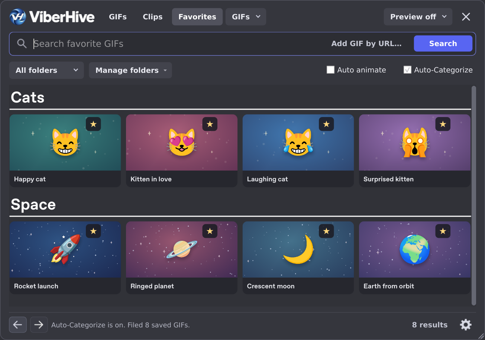
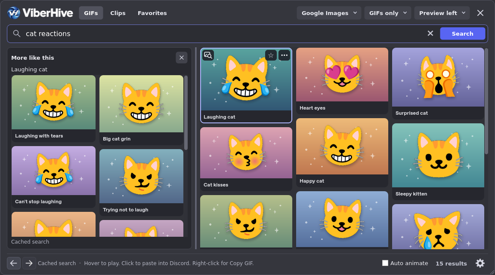

<h1></h1>

ViberHive is a Windows tray app for finding reaction GIFs and quote clips for Discord. Press **Ctrl+F12** in a chat to open the picker. Click a GIF to paste it into your draft, then press **Enter** in Discord when you’re ready to send.

## Install on Windows 11

1. Install standard **64-bit Python 3.13** for Windows. Versions 3.12 and 3.14 x64 also work.
2. Choose **Code → Download ZIP** on GitHub and extract the archive. Run **Setup.cmd** in the extracted folder.
3. Open **ViberHive.lnk** to launch the picker. You can pin the shortcut to Start or the taskbar. Use **Start_in_Tray.cmd** to start in the background.

## Organize Favorites

Star a GIF or clip to save it. In **Favorites**, click a colored folder button to jump to its section in the grouped view. Roll the mouse wheel over the buttons to reach more folders. The white **All Folders** button clears the folder filter and search.

- Turn on **Auto-Categorize** to group recurring subjects. To file a favorite yourself, right-click it and choose **Move to folder**. If the move empties a folder, you can keep or delete it.
- To combine folders, rename one to an existing folder’s name and confirm. **Manage folders → Undo Merge** restores the two folders, even after a restart.

## Find and preview reactions

- **More like this** opens a related GIF search in the main grid. **Middle-click** a GIF in search or Favorites to browse related GIFs in a separate, scrollable Preview pane while keeping your place. **Auto animate** plays visible GIFs in both grids.
- Search GIFs with Google Images, Wikimedia Commons, or KLIPY. Google’s **Visually similar images** searches by appearance. In **Clips**, search Yarn or Clip.Cafe by dialogue, preview the scene, and paste its link.
- On the GIF home screen, drag the divider below **Frequently Used** to show up to eight rows. Reaction and category shortcuts start a new search.

If Google asks for verification, choose **Verify with Google**. If it still requests sign-in, use **Open in browser** or **Search KLIPY**. To save a GIF by its original image address, use **Add GIF by URL** in Favorites.

Favorites, settings, history, and cached media are stored in `%LOCALAPPDATA%\ViberHive`. Quit from the tray before copying that folder for a backup. Search providers receive your queries. The screenshots use sample favorites.
