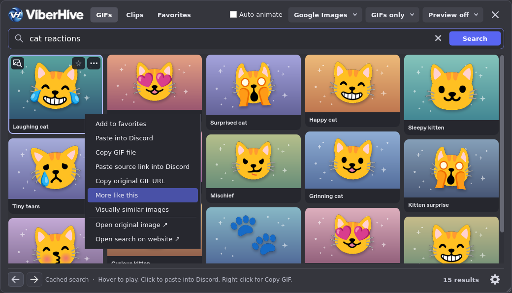
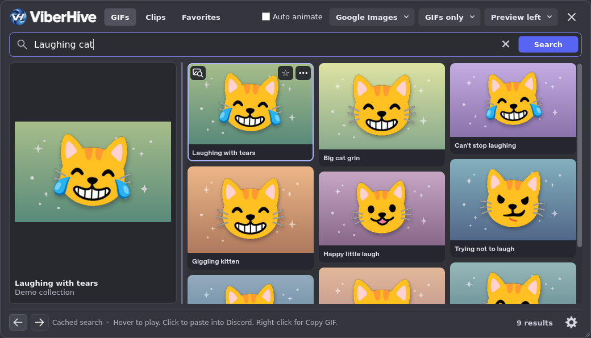
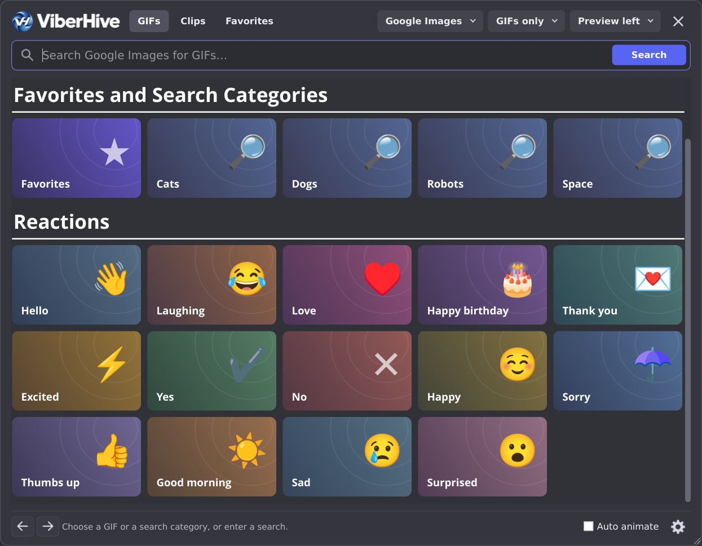

<h1></h1>

A Windows tray app for finding reaction GIFs and short quote clips for Discord. Press **Ctrl+F12** in a chat to bring the picker up near the message box. Pick a reaction, review it in your Discord draft, and send it when ready.

[Install on Windows 11](#install-on-windows-11) · [Organize favorites](#organize-favorites) · [Find related GIFs](#find-related-gifs)

## Organize favorites

Click the **star** on a GIF or clip to save it. Open **Favorites**, choose **GIFs** or **Clips**, and select **All folders** to browse that collection. Each has its own folders and **Auto-Categorize** setting. The screenshots below use a demonstration collection.

- **Group recurring subjects.** Turn on **Auto-Categorize** to file favorites using their titles and the words you originally searched for. For example, “Happy cat” and “Kitten in love” can land in the same **Cats** folder. Items without a recurring subject stay in **Unfiled**. Switch it off to browse newest first.
- **Make your own folders.** Right-click a saved tile and choose **Move to folder → New folder…**, or pick an existing folder. Auto-Categorize respects your manual choices. Use **Manage folders** to rename or delete a folder. Deleting a folder returns its favorites to **Unfiled**.
- **Find something you saved.** Pick a folder and type part of a title, a provider name, or the words you used to find the item. Choose **All folders** to search the whole collection.
- **Save a GIF from the web.** Under **Favorites → GIFs**, choose **Add GIF by URL…**, paste the original image address, and optionally give it a name you’ll remember.

## Find related GIFs

Hover over a GIF and click the **image-and-magnifier icon** in its upper-left corner, or right-click and choose **More like this**. ViberHive searches the selected GIF provider using that tile’s title. If the title is empty, it can use the saved search phrase. This also works from Favorites, so a reaction you saved earlier can start a new search.

See the resulting search for “Laughing cat”

For a **visual match**, right-click an image in Google search results and choose **Visually similar images**. To start from a still image, switch Google from **GIFs only** to **Explore all images** and click a still. Use **Back** or **Forward** to return to a previous grid and scroll position. Mouse side buttons and **Alt+Left / Alt+Right** also work.

## Browse by reaction

Open **GIFs** with an empty search box to see the home screen. **Frequently Used** brings back GIFs you’ve used before. **Favorites and Search Categories** adds shortcuts for recurring search terms and subjects in your saved GIFs. Under **Reactions**, choose a tile such as **Laughing**, **Thank you**, or **Thumbs up** to run that search.

## Preview and share

Press **Enter** to search immediately, or pause for five seconds to search as you type.

| What you want to do | How it works |
| --- | --- |
| Compare animated reactions | Search **Google Images**, **Wikimedia Commons**, or **KLIPY**. Hover to preview a GIF, or turn on **Auto animate** to play the visible grid. Move the larger preview to either side or drag its divider to resize it. |
| Paste a GIF into Discord | Click a GIF to paste it into the current desktop chat. Eligible Google and Commons results paste as animated files. KLIPY results paste as links. To paste a file yourself, right-click and choose **Copy GIF file**, then press **Ctrl+V** in the chat. |
| Find a clip by a line of dialogue | Open **Clips**, enter the quote, and press **Enter**. Use **Auto · clip sources** or select **Yarn.co** or **Clip.Cafe**. Click a result to pin its preview, play or scrub through it, then choose **Paste into Discord** to share its link. |

## Install on Windows 11

1. Install standard 64-bit Python 3.13 for Windows (x64). Python 3.12 and 3.14 x64 are also supported.
2. On the repository page, select **Code → Download ZIP** and extract the entire archive to a folder you intend to keep. You can also clone the repository.
3. Open **Setup.cmd**. It downloads the required packages, checks media playback, and configures the shortcut for this folder.
4. Open **ViberHive.lnk**. To pin it, right-click the shortcut and choose **Pin to Start** or **Show more options → Pin to taskbar**. You can also launch the picker directly with **Run_ViberHive.cmd**.

**Start_in_Tray.cmd** starts ViberHive in the background. Press **Ctrl+F12** to open the picker, or choose **Ctrl+Shift+G** in **Settings**. Press **Esc** or close the picker to hide it. To exit, right-click its tray icon and select **Quit ViberHive**.

### Search providers and Google verification

The public search options work without API keys. For API access, enter optional keys in **Settings** or set `SERPAPI_API_KEY` or `KLIPY_APP_KEY`. SerpApi enables API search for Google and Yarn. A KLIPY app key enables API pagination.

If Google asks for verification, choose **Verify with Google…** and complete the prompt. A sign-in message can still appear after a successful CAPTCHA, including while Google is loading results. If the picker stops there, **Open in browser** continues the same search in your default browser. To keep a result, copy the original GIF address and use **Add GIF by URL…** in Favorites. **Search KLIPY** continues the search inside the picker.

## Local data and privacy

ViberHive keeps favorites, search history, settings, and cached media in `%LOCALAPPDATA%\ViberHive`. To back up your favorites, quit ViberHive from the tray and copy that folder. Project updates can reuse the same profile.

Search providers receive your searches, and media is fetched from the sites hosting it. The embedded Google browser keeps its cookies in memory for the session. Windows protects API keys saved in Settings for the current Windows user. Automatic paste uses the clipboard and the Discord desktop window. You control when the message is sent.
